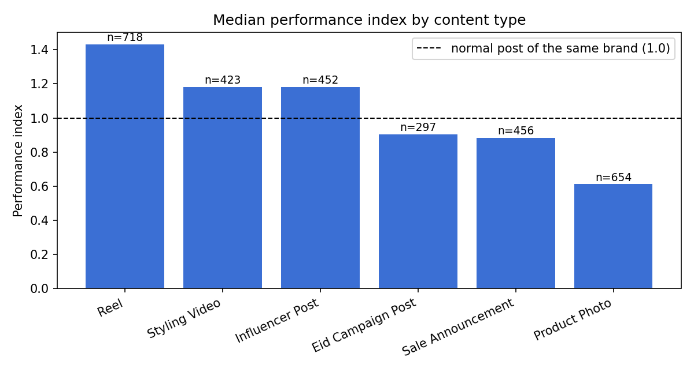
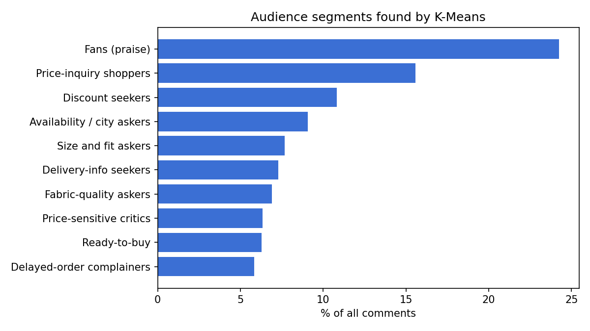
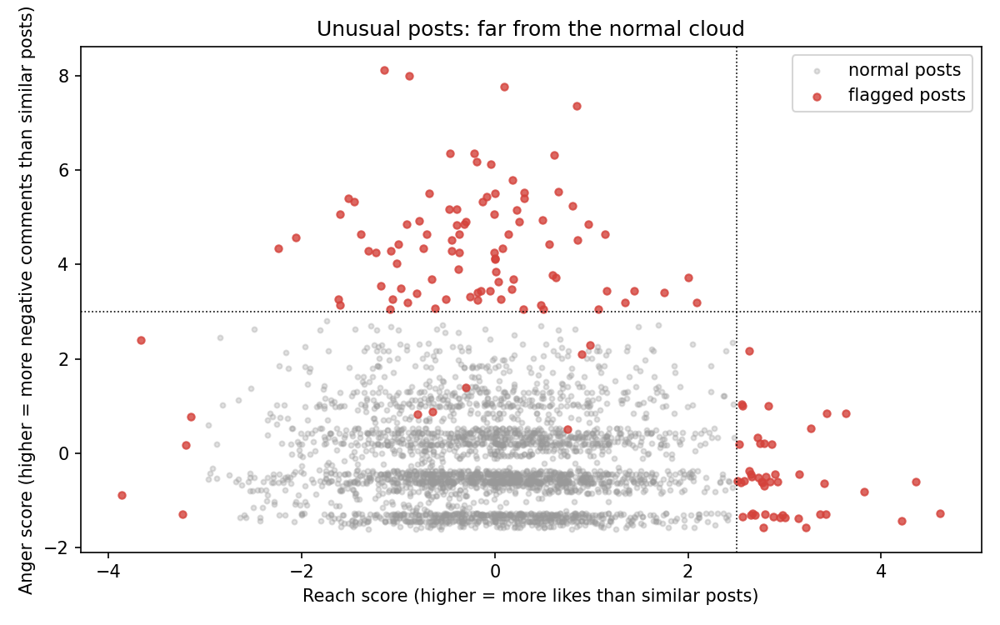

# Big Data Analytics, Project 3

**Pakistan Social Audience & Campaign Intelligence Engine: From Comments to a Marketing Decision**

**Name:** Salman Mansoor
**ID:** F2023376383
**Section:** A2
**Course:** Big Data Analytics
**Repository:** https://github.com/f2023376383-ops/big-data-pipeline-project3

---

## 1. Project idea (business question)

A Lahore-based online clothing brand runs Instagram, TikTok and Facebook campaigns for Eid, 11.11 and 12.12. The marketing team gets thousands of comments such as "Price please?", "Is this available in Karachi?", "Price bohat zyada hai" and "Ordered last week, still waiting". The team does not know which customer needs are hidden inside these comments.

This project builds a small engine that:

1. finds which content attracts attention,
2. groups the comments into audience segments (without telling the computer the topics),
3. finds unusual posts that need a human to look at them,
4. shows which audience needs the brand should address, and
5. turns all of this into actions for the marketing team.

**This project continues Project 1 and Project 2 as one pipeline:**

| Project | What it gives to this pipeline |
| --- | --- |
| Project 1 (organic social media) | Benchmark: how platforms compare for unpaid posts (public dataset) |
| Project 2 (ad budget optimizer) | ROAS and the Rs. 1,000,000 budget split per platform, and ROAS per platform and campaign |
| Project 3 (this project) | Audience segments, content performance, unusual posts and the final recommendations |

The three projects are joined by **platform names** (Instagram, TikTok, Facebook) and **campaign names** (Eid Collection, 11.11 Sale, 12.12 Sale ...). They are **not** joined by the same real customers, because Project 1 is a public dataset and Projects 2 and 3 are simulated.

---

## 2. Files in this repository

| File or folder | What it is |
| --- | --- |
| `run_pipeline.py` | Runs the whole pipeline (8 stages) with one command |
| `app.py` | The website (Streamlit) with the five questions |
| `requirements.txt` | Python libraries |
| `src/generate_data.py` | Creates the simulated posts and comments |
| `src/clean_data.py` | Data quality checks and cleaning |
| `src/p1_social_benchmark.py` | Stage "Project 1": organic benchmark from the public dataset |
| `src/p2_budget.py` | Stage "Project 2": ad metrics and budget recommendation |
| `src/analyze_content.py` | Question 1: which content attracts attention |
| `src/cluster_comments.py` | Questions 2 and 4: audience segments (K-Means) |
| `src/detect_anomalies.py` | Question 3: unusual posts |
| `src/build_recommendations.py` | Question 5: joins Project 1, 2 and 3 into recommendations |
| `src/scaling_test.py` | Bonus: speed test with many more comments (pandas, scikit-learn and Spark) |
| `data/raw/` | Raw files. They are never changed |
| `data/clean/` | Clean data and the results of every stage |
| `outputs/` | Charts, the data quality report and the recommendations report |
| `notebooks/` | The notebooks of Project 1 and Project 2 |

---

## 3. Data (simulated)

**Important note:** The posts and comments in this project are **simulated (synthetic)**. They were generated with Python (NumPy, seed 42, so the data can be repeated). I did not download real comments from Instagram or TikTok, because the project description says not to assume that all comments are downloadable, and scraping is against the platform terms. Every row has `source = simulated`.

The numbers (how many views a Reel gets, how many people ask about the price, and so on) are my own illustrative assumptions. **The results show the method, not facts about real brands.** The brands are called Brand A to Brand F, and no real brand is used.

- **Posts (Table A):** 3,000 posts, 14 columns, from 1 January to 31 December 2025
  (Instagram 1,326, TikTok 912, Facebook 762). One row is one post. The product category is always "Lawn suit".
- **Comments (Table B):** 35,195 comments, 7 columns: Roman Urdu 19,349, English 12,272, Urdu script 3,574. Each post has a sample of up to 12 comments (up to 24 for the posts made to have many complaints).
- **Project 1 data:** a public dataset by Mrudula KP (2,260 posts, five platforms). It is not from Pakistani brands.
- **Project 2 data:** 10,000 simulated ad records (see the Project 2 repository).

### How the simulation works

- Views depend on the platform, the content type, the campaign and the size of the brand. Reels and influencer posts get more reach than product photos.
- The campaign names and dates are the same as in Project 2 (Eid Collection in March and April, 11.11 Sale on 1 to 15 November, and so on).
- Comment topics depend on the campaign (more discount questions during 11.11 and 12.12), the content type (more price questions under a sale announcement) and the platform.
- About 6% of the posts are made unusual **on purpose** (2% viral, 2% many delivery complaints, 2% price anger). This lets me test the detector in Question 3. The column `injected_anomaly` is only for this check and is never used as an input of the model.
- About 25% of the Facebook posts have no views, because "views, if available" is not always public.

### Data dictionary: posts (`posts.csv`)

| Column | Meaning |
| --- | --- |
| post_id | Post number, for example P00001 |
| brand | Brand A to Brand F |
| platform | Instagram, TikTok or Facebook |
| campaign | Winter Collection, Eid Collection, Summer Lawn Sale, 11.11 Sale or 12.12 Sale |
| content_type | Reel, Product Photo, Influencer Post, Styling Video, Sale Announcement or Eid Campaign Post |
| product_category | Lawn suit |
| post_date | Date of the post |
| likes, comments_count, shares | Counts |
| views | Views (blank when not available) |
| days_since_post | Days between the post and the collection date (15 January 2026) |
| source | Always `simulated` |
| injected_anomaly | viral, delivery_surge, price_backlash or blank (only for testing the detector) |

### Data dictionary: comments (`comments.csv`)

| Column | Meaning |
| --- | --- |
| post_id | Link to the post |
| comment_text | The comment |
| language_type | English, Roman Urdu or Urdu |
| topic | Reference topic used to create the comment (price_inquiry, delivery_complaint ...). **The clustering never sees this column.** I only use it afterwards to check the clusters |
| sentiment | Positive, Neutral or Negative |
| purchase_intent | High, Possible inquiry, Existing customer or None |
| source | Always `simulated` |

---

## 4. How to run

```bat
pip install pandas numpy scikit-learn matplotlib streamlit
python run_pipeline.py        :: runs all 8 stages (about 1 minute)
streamlit run app.py          :: opens the website in the browser
```

- `python run_pipeline.py --keep-data` keeps the existing simulated data and only runs the other stages.
- Each stage can also be run alone, for example `python src\cluster_comments.py`.
- The stage for Project 1 downloads the public dataset once (internet needed) and saves it in `data/raw/`.
- The bonus scaling test needs `pip install pyspark` and Java. If they are missing, the Spark part is skipped: `python src\scaling_test.py`.

**Tools used:** Python, Pandas, NumPy, scikit-learn, Matplotlib, Streamlit, PySpark (bonus).

---

## 5. What I did (step by step)

### Step 1: Create the data

`generate_data.py` creates `posts.csv` and `comments.csv` in `data/raw/`.

### Step 2: Data quality checks and cleaning

I checked the data first and cleaned a copy. The raw files stay unchanged.

| Check | Result |
| --- | --- |
| Posts: rows and columns | 3,000 rows, 14 columns |
| Comments: rows and columns | 35,195 rows, 7 columns |
| Duplicate post_id | 0 |
| Negative likes, comments, shares or views | 0 |
| Likes greater than views (not possible) | 0 |
| Comments without a matching post | 0 |
| Posts with no comment in the sample | 0 |
| Urdu-script text labelled as another language | 0 |
| Views missing | 203 posts (6.8%), all of them on Facebook |

Three decisions:

- **Missing views stay blank.** I did not fill them with 0 or the average, because "not collected" is not the same as "zero". The engagement rate is calculated only for the 2,797 posts that have views.
- **Repeated comments are kept.** 95% of the comment texts are repeated, because many people write "Price?". The same wording from many people shows demand, so it is a signal and not an error.
- **Roman Urdu spelling is unified.** There is no fixed spelling ("bohat", "bohot", "boht"), so common variants are changed to one spelling. Emojis and punctuation are removed in a new column `text_clean`; the original comment is kept.

### Step 3: Question 1, which content attracts attention?

A big brand gets more likes than a small brand for any post. So I compared each post with the typical post of **the same brand on the same platform**:

`performance index = likes / median likes of that brand and platform` (1.0 is normal, 1.5 is 50% better)

I used the median and not the mean, like in Project 1, so a few viral posts do not change the result.

| Content type | Posts | Median likes | Median performance index |
| --- | --- | --- | --- |
| Reel | 718 | 1,352 | 1.43 |
| Styling Video | 423 | 1,148 | 1.18 |
| Influencer Post | 452 | 1,065 | 1.18 |
| Eid Campaign Post | 297 | 908 | 0.90 |
| Sale Announcement | 456 | 845 | 0.89 |
| Product Photo | 654 | 593 | 0.61 |

- Reels do best and product photos do worst.
- By campaign, Eid Collection (1.22) and the 12.12 Sale (1.17) do best. Winter Collection does worst (0.79).
- TikTok has the highest median likes (2,747), then Instagram (930) and Facebook (258).
- **Be careful:** the engagement rate (likes + comments + shares per view) is almost the same for every content type (5.6% to 6.1%). In my simulation the content type changes the **reach**, not how much the viewers like the post. In real data this can be different.

Charts: `outputs/q1_content_type.png`, `q1_heatmap.png`, `q1_campaign.png`.



### Step 4: Questions 2 and 4, audience segments (clustering)

I used **K-Means** on the comments (TF-IDF features, k = 10). The model does not see the `topic` column.

**Problem I found:** if I use only the text, the clusters follow the **language** and not the need. "Price please?", "Price kya hai?" and the Urdu-script version share almost no words, so they land in different clusters. The match with the reference topics was very low (ARI 0.08).

**My fix:** I wrote a short keyword list (price, delivery, size, discount, fabric ...) in English, Roman Urdu and Urdu. When a comment contains a keyword, a "concept token" is added to the text. This is normal feature engineering, but it is **my own knowledge put into the model**, so it must be mentioned. With it the match went up to ARI 0.97 (NMI 0.98). Over 5 different random seeds, ARI stayed between 0.90 and 1.00.

**Why k = 10:** the silhouette score keeps rising slowly when k grows, because many comments are word for word identical. So I did not choose k from one number. At k = 10 the segments are clear, separate and easy to read.

| Segment | Comments | Share | Negative |
| --- | --- | --- | --- |
| Fans (praise) | 8,530 | 24.2% | 0% |
| Price-inquiry shoppers | 5,481 | 15.6% | 0% |
| Discount seekers | 3,808 | 10.8% | 0% |
| Availability / city askers | 3,193 | 9.1% | 0% |
| Size and fit askers | 2,697 | 7.7% | 0% |
| Delivery-info seekers | 2,562 | 7.3% | 0% |
| Fabric-quality askers | 2,426 | 6.9% | 27% |
| Price-sensitive critics | 2,234 | 6.3% | 100% |
| Ready-to-buy | 2,206 | 6.3% | 0% |
| Delayed-order complainers | 2,058 | 5.8% | 100% |

- The two groups with 100% negative comments (**Price-sensitive critics** and **Delayed-order complainers**) are the most urgent for the marketing team.
- All three platforms have the same top three segments (Fans, Price-inquiry shoppers, Discount seekers). TikTok has the most fans (28%).
- The segment names are suggested from the most common reference topic in each cluster. In real work I would read the top words and name each cluster myself.

**Honest note:** the data is made from short templates and the keyword list is mine. So ARI 0.97 shows that **the pipeline works**. Real Pakistani comments are messier and the score would be lower. I do not claim this accuracy for real brands.

Charts: `outputs/q2_segment_sizes.png`, `q2_scatter.png`, `q2_by_platform.png`.



### Step 5: Question 3, unusual posts

Each post is compared with posts of **the same platform and content type**, using robust z-scores (median and MAD, so extreme posts do not spoil the comparison). Three signals:

1. **Reach:** performance index much higher (possible viral post) or much lower (possible flop).
2. **Chatter:** many more comments per like than similar posts.
3. **Anger:** the share of negative comments is much higher than normal. I used a binomial z-score, because 1 negative out of 3 comments is much less reliable than 8 negative out of 24.

Result: **146 of 3,000 posts (4.9%) were flagged.** Reasons: many negative comments (89, with the main segment named, for example Price-sensitive critics), viral reach (46), more comments per like (6), flop (5). TikTok has the highest share of flagged posts (6.2%).

**Check with the injected posts:** I made 178 posts unusual on purpose, so I can check the detector. Precision is 79% (flagged posts that were really injected) and recall is 65% (injected posts that were found). Posts with very few comments are hard to judge, so some are missed.
**This check is only possible because the data is simulated.** With real data there is no answer key, so a flag only means "please investigate this post", not "this post is bad".

I first tried Isolation Forest (a popular anomaly algorithm) on the same signals. It gave a much lower precision, so I kept the simple z-score method, which is also easier to explain.



### Step 6: Join Project 1, Project 2 and Project 3 (Question 5)

`build_recommendations.py` joins, for every platform and campaign:

- **Project 3:** the biggest audience segments in the comments, the best content type, the number of unusual posts
- **Project 2:** the ROAS of the platform, the ROAS in that campaign and the recommended budget share
- **Project 1:** the organic benchmark of the platform

Project 2 result used here (Rs. 1,000,000 split, same as in the Project 2 document):

| Platform | ROAS | Budget (Rs.) |
| --- | --- | --- |
| Instagram | 6.02 | 246,000 |
| Google | 5.90 | 241,000 |
| Facebook | 5.16 | 210,000 |
| TikTok | 4.37 | 178,000 |
| YouTube | 3.08 | 125,000 |

Google and YouTube have no social comments in this project, so the audience part covers Instagram, TikTok and Facebook.

**How actions are chosen:** every segment has one action rule that I wrote (marketing common sense). The data decides **which segments come first**: score = share of comments x weight (angry segments x2, ready-to-buy x1.5, fans x0.5). The top 3 actions are kept for each platform and campaign, with the evidence and a metric to check. Result: 45 recommendations (3 platforms x 5 campaigns x 3 actions) in `data/clean/final_recommendations.csv` and a readable report in `outputs/marketing_recommendations.md`.

**Example: TikTok, 11.11 Sale**

1. **Content, Price-inquiry shoppers (20% of comments):** put the price in the first line of the caption and in a pinned comment. Check: number of "price?" comments per 100 comments.
2. **Promotion, Discount seekers (16%):** run a time-limited discount code and announce it in the post.
3. **Content, Fans (22%):** reuse the most praised designs as social proof.
4. Project 2 note: ROAS in this campaign (4.9) is higher than TikTok overall (4.4), so it is a good place to run the test.

### Step 7: The website

`streamlit run app.py` opens a website with seven tabs: Pipeline, the five questions, and Limits. The filters on the left (platform and campaign) change all the question tabs. The website only shows the results; all calculations are done by the pipeline.

### Step 8 (bonus): What happens when the data gets bigger?

`scaling_test.py` copies the comments 1, 5, 10 and 20 times (up to about 700,000 comments) and measures the time of a group-by count, TF-IDF and K-Means with pandas and scikit-learn, and the same steps with Spark (local mode). Results are saved in `data/clean/scaling_results.csv` and `outputs/scaling_times.png`.

How to read the result:

- Copied comments carry **no new information**. The test measures speed and the limits of the tools, not the quality of the clusters.
- Spark needs time to start, so on a small file one computer with pandas is often faster.
- Spark is useful when the data no longer fits in the memory of one computer, or when many machines work together. My test ran Spark on **one** computer, so it cannot show that advantage.

---

## 6. What the marketing team should do

- Use **Reels** and styling or influencer videos more, and use product photos less (Question 1).
- Answer the most common questions before people ask: put the **price** in the caption (16% of comments ask for it) and announce a **discount code** during 11.11 and 12.12 (Questions 2 and 4).
- Give customer service a named person for **delayed-order complaints** and look at the **price anger** posts first (Question 3).
- Spend the budget as in Project 2, and run the audience tests first where ROAS in a campaign is higher than the platform average (Question 5).
- Every action is a **test for a few weeks**. Compare the result with the same metric each time.

---

## 7. What are the limits?

- **All Project 2 and Project 3 data is simulated.** The results show the method, not facts about real brands or the real market.
- **The keyword list is mine.** Without it the comments split by language and not by need. A high ARI means the pipeline works, not that real comments would be this easy.
- **Clusters do not prove a reason.** Comments show what people say, not why.
- **Unusual posts are only flagged for a human to look at.** Posts with few comments are hard to judge.
- **ROAS is not profit.** The expected revenue assumes ROAS stays the same when the spend changes, and this is not guaranteed.
- **The three projects are joined by platform and campaign names,** not by the same customers. Project 1 is a public dataset and not from Pakistani brands.
- In the simulation content type changes reach, not the engagement rate, so the Question 1 result depends on my assumption.
- Google and YouTube have no comment data here.
- Numbers can change slightly when the library versions are different (for example in K-Means).

---

## 8. Links

- Project 1: https://github.com/f2023376383-ops/big-data-project1-social-media
- Project 2: https://github.com/f2023376383-ops/big-data-project2
- Project 3 (this repository): https://github.com/f2023376383-ops/big-data-pipeline-project3
